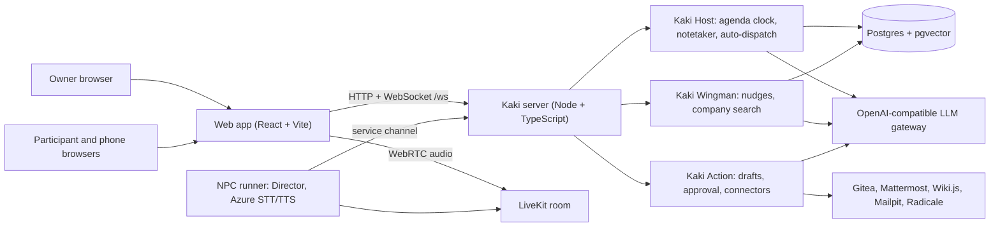

# Kaki: a meeting assistant with a private wingman for every seat

Kaki is a web meeting assistant for small teams. The owner plans an agenda, participants join a LiveKit meeting room with a six-character code or an invite link, and three server agents work alongside the call. Kaki Host keeps the agenda clock, reads the transcript, finds open questions and follow-ups, and dispatches work. Kaki Wingman gives each seat private, role-aware nudges and answers from the team's own company records. Kaki Action drafts an issue, post, wiki page, email or calendar event and writes it only after the assignee approves the draft. A separate NPC runner plays AI colleagues for practice meetings, so one person can rehearse the whole meeting before running it with a team.

The project was built for IT5007 at NUS. It is also a working demo of the design: a self-hosted company stack (Postgres with pgvector, Wiki.js, Gitea, Mattermost, Mailpit, Radicale), a LiveKit room, Azure Speech, and an OpenAI-compatible LLM gateway.

## Team

| Name | Matriculation number | Area |
| --- | --- | --- |
| Xiao Xiao | A0332142W | Kaki Host |
| Joshua Lum Zi Yuan | A0108499N | Kaki Wingman |

## Contents

- [1. Live demo (Azure VM)](#1-live-demo-azure-vm)
- [2. Problem statement](#2-problem-statement)
- [3. Architecture](#3-architecture)
- [4. Front-end features](#4-front-end-features)
- [5. Back-end features](#5-back-end-features)
- [6. Novelty](#6-novelty)
- [7. Software engineering](#7-software-engineering)
- [8. Setup, integrations and commands](#8-setup-integrations-and-commands)
- [9. Project management](#9-project-management)
- [10. Competitor analysis](#10-competitor-analysis)
- [11. Legal and open source](#11-legal-and-open-source)
- [12. Business model](#12-business-model)
- [13. Borrowed code, services and AI assistance](#13-borrowed-code-services-and-ai-assistance)
- [14. Repository structure](#14-repository-structure)
- [15. Sources](#15-sources)

See also the [Live Demo Architecture](docs/live-demo.md), [How we tested](docs/testing.md), the [Domain Glossary](CONTEXT.md) and the [STePS poster](docs/poster/kaki-a1-poster.pdf).

---

## 1. Live demo (Azure VM)

The project is deployed on Azure (`kaki-vm` in `KAKI-BOT-RG`, Southeast Asia) with automatic Let's Encrypt HTTPS for browser and phone microphone support:

- **Main Meeting App:** **`https://kaki.southeastasia.cloudapp.azure.com`**
  - **Practice** (AI colleagues fill the seats): open `/practice`, no sign-in needed.
  - **Real meeting** (you chair, others join with your invite code): sign in as the meeting owner with `demo@kaki.demo` / `demo`.
- **Cloud Company Systems (Unified Login: `demo` / `demo`):**
  - **Wiki.js:** `http://kaki.southeastasia.cloudapp.azure.com:8081` (`demo` / `demo`)
  - **Gitea:** `http://kaki.southeastasia.cloudapp.azure.com:8082` (`demo` / `demo` — or NPC usernames `wei-ling`, `arjun`, `mei`, `daniel` with password `demo`)
  - **Mattermost:** `https://kaki.southeastasia.cloudapp.azure.com:8443` (`demo` / `demo` — or NPC usernames `weiling`, `arjun`, `mei`, `daniel` with password `demo`)
  - **Mailpit (Email Inbox):** `http://kaki.southeastasia.cloudapp.azure.com:8084` *(no login required)*
  - **Radicale Calendar:** `http://kaki.southeastasia.cloudapp.azure.com:5232` (`demo` / `demo`)

### Waking or stopping the cloud VM

To save Azure student credits, `kaki-vm` automatically deallocates itself after **2 hours of zero visitor activity**. Anyone with Azure CLI access to `KAKI-BOT-RG` (or via the Azure Portal **Start** button) can wake it up in about 45 seconds:

```bash
npm run cloud:status   # Check if kaki-vm is running and https://kaki.southeastasia.cloudapp.azure.com is online
npm run cloud:up       # Start kaki-vm and wait until the live site and all integrations are ready
npm run cloud:down     # Immediately deallocate kaki-vm ($0/hr compute billing)
```

---

## 2. Problem statement

A meeting host has to present, watch the clock, keep the agenda, draw out quiet experts, answer factual questions and record who agreed to do what. In a hybrid meeting this is harder because side conversations and body language are lost. The result is predictable: meetings overrun, questions stay open because the person who knows the answer is not speaking, and spoken action items are forgotten because nothing turns them into a ticket, a post or an email.

Most meeting assistants record and summarise after the call. Some answer questions during it, but as one shared assistant for the whole room. The hard part is not the summary. It is knowing when to stay silent, who needs which fact, and how to act in another system without surprising anyone. Kaki splits that work across a neutral host, a private wingman for each participant, and an action agent that waits for the person's approval before it writes anything.

The problem lasts. In two years, live and personalised help will be the expected part of a meeting assistant, not the recap. In five years, teams will expect a meeting to produce finished work, not just notes. In ten years, the assistant will be part of how a team operates, and the difficult questions will be trust, permissions and knowing when not to speak. Kaki is built for that layer rather than for the transcript.

---

## 3. Architecture



The diagram shows the running system. The web app holds no API keys and talks only to the Kaki server and to LiveKit with a room token from the server. Every LLM call, Azure Speech call and company-tool write is made by the server or by the NPC runner.

The four agents:

1. **Kaki Host (`server/src/host/`):** owns the agenda clock, runs the grounded notetaker, keeps the meeting record, detects open questions and action items, auto-dispatches follow-ups to the right role, and triggers the closing summary.
2. **Kaki Wingman (`server/src/wingman/`):** sends private, role-filtered nudges when an agenda item is about to start or a role has been quiet, and answers questions from company records using PostgreSQL with `pgvector` and `bge-m3` embeddings.
3. **Kaki Action (`server/src/action/`):** drafts a concrete external artifact for an accepted task and runs it after the assignee approves the draft, across Gitea, Mattermost, Wiki.js, Mailpit and Radicale CalDAV. It also drafts the end-of-meeting minutes as a card for a person to approve before the wiki write.
4. **NPC Director and runner (`server/src/npc/`):** plays the AI colleagues in a practice meeting over LiveKit, using Azure Speech for recognition and synthesis, voice-activity detection and barge-in. One LLM, the Director, plays every AI attendee and decides who speaks, one at a time.

Meeting state belongs to one server process. Each event carries its audience (the shared screen, one role, everyone, or the service channel), and the server decides who receives it. A phone joins with the meeting code and picks a seat, which is routing rather than identity verification. The privacy property the code implements is that role-private events go only to that role's connection.

Durable state lives outside the process: host accounts and sessions in Postgres, meeting state and knowledge vectors in Postgres with `pgvector`, and approved drafts in the company systems once written. The task store (`server/src/meeting/tasks.ts`) is the only code that changes task state, and it enforces the lifecycle.

---

## 4. Front-end features

The web app is one React and Vite application with seven routes: landing, practice, join, owner meeting, sign-in, setup and a redirect home (`web/src/App.tsx`).

- **Landing page:** choose a team meeting or a practice meeting, or enter an invite code `web/src/landing/LandingPage.tsx`.
- **Practice meeting:** `/practice` and `/demo` open the Kopitiam practice room, with AI colleagues in the other seats `web/src/meeting/room/Meeting.tsx`.
- **Host sign-in:** email and password form, with a return path limited to the app's own routes `web/src/auth/LoginPage.tsx`.
- **Setup editor:** edit the title, organisation, agenda items, roles, seats and nudge pace, with per-field validation messages and a demo import `web/src/setup/SetupPage.tsx`, `web/src/setup/SetupEditor.tsx`.
- **Owner lobby:** share the invite link and meeting code, show a QR code, list who has joined, start the meeting or close the room `web/src/meeting/MeetingOverlays.tsx`.
- **Join form:** name, seat, microphone and camera choice, and the meeting code when one is needed `web/src/meeting/room/JoinForm.tsx`, `web/src/meeting/TeamJoinForm.tsx`.
- **Waiting room:** a participant sees a waiting card until the owner starts the meeting `web/src/meeting/MeetingOverlays.tsx`.
- **Meeting stage:** LiveKit tiles with speaking state, live captions, reaction badges and AI-attendee state `web/src/meeting/room/MeetingGrid.tsx`, `web/src/meeting/room/CaptionedTile.tsx`, `web/src/meeting/room/stageModel.ts`.
- **Start briefing:** a two-screen briefing covers the stage until the visitor presses Start; the AI colleagues stay silent before that `web/src/meeting/room/StartPrompt.tsx`.
- **Wingman dock:** a collapsible role card, the situation, active task cards, the agenda clock, topic cheat sheet, transcript and task board in one side panel `web/src/meeting/room/Dock.tsx`, `web/src/meeting/room/ActiveRoleCards.tsx`, `web/src/meeting/room/MeetingPanel.tsx`.
- **Minutes approval:** the end-of-meeting minutes arrive as a task card with an editable draft and an **Approve & publish** action; the wiki link appears only after the write `web/src/meeting/room/ActiveRoleCards.tsx`.
- **Type bar and pause:** type to the AI colleagues instead of speaking, send a line, or pause and resume the meeting clock `web/src/meeting/room/TypeBar.tsx`.
- **Microphone and sound controls:** choose devices before joining, show a live level, and offer a tap-to-unlock button when a phone blocks playback `web/src/meeting/room/MediaPreview.tsx`, `web/src/meeting/room/AudioUnlock.tsx`.
- **Phone layout:** narrow screens stack the stage above the dock and keep the type bar at the bottom `web/src/meeting/room/demo.css`.
- **Live updates:** one hook subscribes to the server's WebSocket, keeps the event window and the task list, and exposes a send function `web/src/kaki/useKaki.ts`.
- **Rejoin:** a reload or dropped connection keeps the same name and seat, with a countdown while the seat is held `web/src/meeting/room/rejoinSession.ts`.
- **Form validation:** join and setup forms disable their submit action until the required fields are valid, and show the server's refusal next to the form `web/src/meeting/room/JoinForm.tsx`, `web/src/meeting/TeamJoinForm.tsx`, `web/src/setup/SetupEditor.tsx`.

---

## 5. Back-end features

- **WebSocket hub and typed protocol:** one hub routes events by audience and collects commands; events are validated before delivery and commands are validated against the scenario `server/src/core/hub.ts`, `shared/src/events.ts`, `shared/src/commands.ts`.
- **HTTP routes:** one route table declares every path and its access level (public, session, host, host-or-practice, service or dev); an unlisted path is a 404 `server/src/app.ts`, `server/src/http/routes/`.
- **Sign-in and sessions:** host accounts with scrypt password hashes, 12-hour sessions, and separate host, seat and practice sessions `server/src/auth/module.ts`, `server/src/auth/password.ts`, `server/src/auth/cookie.ts`.
- **Meeting codes:** six characters from an alphabet without look-alikes, shared by phone joins and LiveKit admission, with five wrong attempts allowed per address per minute `server/src/meeting/meetingCode.ts`, `server/src/auth/module.ts`.
- **Meeting sessions and rejoin:** an explicit lobby, starting, running and ended lifecycle; an empty room holds the same person's seat for a grace period, and a restored meeting keeps its code and start time `server/src/meeting/session.ts`, `server/src/meeting/rejoin.ts`.
- **Setup parsing and validation:** the same parser runs in the browser and on the server, checking role ids, unique labels, agenda owners, seat kinds, nudge pace and required fields `shared/src/setupParse.ts`, `shared/src/setupScenario.ts`, `server/src/http/routes/setup.ts`.
- **Agenda clock:** current item, elapsed time, overrun signal, pause and resume, with a replay speed for scripted runs `server/src/host/clock.ts`.
- **Notetaker:** LLM passes over new transcript lines produce the meeting record, with question and task grounding, a separate meaning verifier, and a strict JSON schema for replies `server/src/host/notetaker.ts`, `server/src/host/notetakerQuestions.ts`, `server/src/host/notetakerTasks.ts`, `server/src/host/notetakerVerifier.ts`, `server/src/host/notetakerPrompt.ts`.
- **Auto-dispatch:** suggested tasks go to their suggested role unless a person holds the host seat; held cards wait for the agenda item to settle `server/src/host/autoDispatch.ts`.
- **Wingman nudges:** a coming-up nudge before the next item and a quiet-owner nudge during the current item, each delivered only to that role `server/src/wingman/nudges/module.ts`.
- **Company search:** hybrid retrieval over `pgvector` vector search and Postgres full-text search, merged with reciprocal rank fusion, then a role-aware answer with source and date for each fact `server/src/wingman/knowledge/search.ts`, `server/src/wingman/knowledge/gateway.ts`.
- **Knowledge indexer:** reads Wiki.js, Gitea, Mattermost, Mailpit and Postgres, chunks the records and writes 1024-dimension `bge-m3` embeddings `server/src/wingman/knowledge/indexer.ts`, `server/src/wingman/knowledge/cli.ts`.
- **Action drafts and approval:** the task store enforces `SUGGESTED`, `DISPATCHED`, `CLAIMED`, `DRAFT_READY`, `RUNNING`, `COMPLETED`, `SYNCED`; only the assignee can approve, and a draft is checked against its source before it runs `server/src/meeting/tasks.ts`, `server/src/action/runner.ts`, `server/src/action/draftGrounding.ts`.
- **Five connectors:** Gitea issues, Mattermost posts, Mailpit email, Wiki.js pages and Radicale calendar events `server/src/action/gitea.ts`, `server/src/action/mattermost.ts`, `server/src/action/email.ts`, `server/src/action/wiki.ts`, `server/src/action/calendar.ts`.
- **Minutes to wiki:** on the closing signal, Kaki builds Markdown minutes from the record, tasks and transcript, assigns the card to a person in the room, and writes to Wiki.js only after that person approves `server/src/action/wiki.ts`.
- **NPC Director and runner:** one Director plays every AI attendee from scenario profiles; the runner joins LiveKit, publishes audio, recognises only the visitor's speech with Azure STT, synthesises with Azure TTS, and stops on barge-in `server/src/npc/director.ts`, `server/src/npc/conversation.ts`, `server/src/npc/runner.ts`, `server/src/npc/vad.ts`, `server/src/npc/speechGate.ts`.
- **Scenario packs:** roles, attendees, AI profiles, agenda, seed data and replay fixtures load from `scenarios/<id>/`, selected with `SCENARIO`; the server and meeting logic read the active folder `server/src/core/loadScenario.ts`, `scenarios/README.md`.
- **Seeding:** idempotent seed scripts load the Kopitiam company records into all five services and the database `docker/seed/index.ts`, `docker/seed/gitea.ts`, `docker/seed/mattermost.ts`, `docker/seed/wiki.ts`, `docker/seed/mail.ts`, `docker/seed/calendar.ts`, `docker/seed/postgres.ts`.
- **One-command start:** `npm start` checks Docker and `.env`, brings up the stack, seeds it, indexes knowledge, starts the server, web app and NPC runner, then runs a preflight `scripts/live-up.sh`.
- **Cloud scripts:** start the Azure VM and wait for health, deallocate it, or report its state `scripts/cloud.sh`.

---

## 6. Novelty

Kaki's difference is the split between a shared host, a private wingman for each seat, and an action agent that runs only after approval.

- **A private wingman per person.** Nudges and company facts are addressed to one role's socket. The company search prompt is written for that role, and the answer carries a source and date.
- **AI colleagues for practice.** One person can run the whole meeting with AI attendees who speak, take turns, react and allow barge-in before facing a real team.
- **Approval-gated actions across tools.** The host dispatches a follow-up, the assignee receives a draft, and the draft is checked against the transcript before it can run. Nothing is written to Gitea, Mattermost, the wiki, email or the calendar without that approval.
- **A grounded notetaker with a verifier.** The notetaker proposes questions and tasks only from transcript evidence, and a second pass judges meaning rather than word overlap. Doubtful judgements are shown as unresolved instead of being guessed.

---

## 7. Software engineering

The repository is a TypeScript workspace with three packages: `shared/`, `server/` and `web/`. `shared/` holds the protocol and the rules both sides must agree on, including events, commands, task states, scenario parsing and setup parsing. The server is split by responsibility (`core`, `http`, `meeting`, `host`, `wingman`, `action`, `npc`, `auth`, `persist`), and the web app by page and feature (`landing`, `auth`, `setup`, `meeting`, `kaki`, `ui`, `net`).

Scenario packs are folders. A pack supplies roles, attendees, AI profiles, agenda, company seed data and a replay transcript, and `SCENARIO` names the folder to load (`kopitiam` by default). The server, meeting state and agents read everything scenario-specific from that folder (`server/src/core/loadScenario.ts`).

Input is validated on both sides. The setup parser checks the plan before it is saved, and the server re-checks every setup write. Commands from a socket are validated against the scenario before the hub accepts them. The action connectors reject a draft that adds details the source does not support.

Every exported function, component and type has a short comment stating what it does, for example `server/src/core/hub.ts:66` and `shared/src/events.ts:29`.

Tests sit with the code and are mirrored under `server/test/`. `npm test` runs the Vitest suite for `shared/`, `server/`, `web/`, `scripts/` and the seed code, including unit tests and integration tests that drive the HTTP and WebSocket API. `npm run typecheck` checks the whole workspace.

There are 156 test files:

```bash
find . -type d -name node_modules -prune -o -type f \( -name '*.test.ts' -o -name '*.test.tsx' \) -print | wc -l
```

Playwright drives the real app in installed Google Chrome:

- `npm run playtest:team` runs a typed three-person meeting, including the lobby, meeting code, private cards, follow-up approval and minutes published to the wiki.
- `npm run playtest:team -- --voice` runs the same meeting with generated speech through a fake microphone.
- `npm run playtest:live` runs one visitor through the practice meeting with the AI colleagues.
- `npm run playtest:ai` lets a language model play the visitor in one of nine styles, then a second model judges the meeting.

See [How we tested Kaki](docs/testing.md) for the full test map.

---

## 8. Setup, integrations and commands

### Local Quickstart

Requires **Node 22+** and **Docker Desktop**.

#### Step 1: Configure `.env`

Copy `.env.example` to `.env` and fill in the five required keys: your OpenAI-compatible LLM gateway (`KAKI_LLM_BASE_URL`, `KAKI_LLM_API_KEY`, `KAKI_LLM_MODEL`) and Azure Speech (`AZURE_SPEECH_KEY`, `AZURE_SPEECH_REGION`):

```bash
cp .env.example .env
```

#### Step 2: One command

```bash
npm start
```

This installs dependencies if `node_modules` is missing, starts the seven Docker containers, seeds the **Nanyang Kopi & Toast (`kopitiam`)** scenario into Postgres, Wiki.js, Gitea, Mattermost, Mailpit and Radicale Calendar, indexes the knowledge chunks into `pgvector`, starts the Kaki server (:3001), Vite web (:5173) and the AI attendees, then runs the preflight. It stops early with the exact fix if Docker is not running, `.env` is missing, or a required key is empty. The seed generates the Gitea and Mattermost tokens in `docker/.env`, and `npm start` passes them to Kaki for you.

Once running, open **`http://localhost:5173`** (or `http://localhost:5173/demo`) in Chrome.

#### Step 3: Stop

```bash
npm stop              # stop the Kaki server, web app and AI attendees
npm stop -- --stack   # also stop the Docker containers
```

### Active External Integrations and Unified Logins (`demo` / `demo`)

All backing services run via [`docker/docker-compose.yml`](docker/docker-compose.yml) (see [docker/README.md](docker/README.md)) and use **`demo` / `demo`** as the unified login:

| Integration | Purpose | Local Endpoint | Login | Module |
| --- | --- | --- | --- | --- |
| **Gitea** | Creates engineering and ops issues from approved drafts | `http://127.0.0.1:8082` | `demo` / `demo` (or `wei-ling`, `arjun`, `mei`, `daniel` / `demo`) | `server/src/action/gitea.ts` |
| **Mattermost** | Posts announcements and updates to team channels | `http://127.0.0.1:8083` | `demo` / `demo` (or `weiling`, `arjun`, `mei`, `daniel` / `demo`) | `server/src/action/mattermost.ts` |
| **Wiki.js** | Publishes team wiki pages and approved end-of-meeting minutes | `http://127.0.0.1:8081` | `demo` / `demo` | `server/src/action/wiki.ts` |
| **Mailpit** | Sends drafted emails via SMTP and serves a web inbox | `http://127.0.0.1:8084` | No login required | `server/src/action/email.ts` |
| **Radicale (CalDAV)** | Books `.ics` calendar events and serves the seeded Kopitiam calendar | `http://127.0.0.1:5232` | `demo` / `demo` | `server/src/action/calendar.ts` |
| **PostgreSQL + pgvector** | Stores company records and 1024-dimension `bge-m3` embeddings | `127.0.0.1:5433` | `kaki` / `kaki_dev_password` | `server/src/wingman/knowledge/` |
| **LiveKit + Azure Speech** | Real-time WebRTC audio room, server VAD, STT and multi-voice TTS | `ws://127.0.0.1:7880` | `devkey` / `secret` | `server/src/npc/` |

When a human visitor joins with their name, Kaki updates the `demo` profile display name in Gitea and Mattermost to match the visitor, or posts from the person's own account when it exists. Tasks completed by AI colleagues are posted from each AI attendee's own account (`arjun`, `mei`, `daniel`, `weiling` or `wei-ling`).

### Useful Commands

```bash
npm start                 # One-command local demo: checks, Docker, seed, index, server + web + AI, preflight
npm stop                  # Stop local server, web app and AI attendees (add -- --stack for Docker)
npm run live:up           # Same as npm start (older name)
npm run live:down         # Same as npm stop
npm run cloud:up          # Start Azure VM (kaki-vm) and wait for https://kaki.southeastasia.cloudapp.azure.com
npm run cloud:down        # Deallocate Azure VM ($0/hr compute billing)
npm run cloud:status      # Check Azure VM state and live HTTPS health
npm run stack:up          # Start the seven Docker containers
npm run stack:down        # Stop the Docker containers
npm run seed              # Idempotently seed all Docker services with the Kopitiam scenario
npm run seed:verify       # Run 16 automated health and content checks against the Docker stack
npm run index:knowledge   # Embed and index seeded company records into pgvector
npm run knowledge:check   # Verify live pgvector semantic search and role-filtered facts
npm run npc               # Run the AI attendees against a local stack
npm run playtest:team     # Typed three-person Playwright meeting
npm run playtest:live     # One visitor through the practice meeting
npm run typecheck         # Type-check all workspaces (@kaki/shared, @kaki/server, @kaki/web)
npm test                  # Run the full Vitest suite
```

---

## 9. Project management

Work was tracked in GitHub issues for the repository `IT5007-2610/it5007-courseproject-group-14`, read and updated with the `gh` CLI. The issue labels follow five triage roles: `ready-for-agent`, `needs-triage`, `needs-info`, `ready-for-human` and `wontfix`.

The plan ran in phases: the core stack and protocol first, then the three agents, then the live meeting and demo, then the submission clean-up. Within those phases the issues are grouped by area rather than by calendar week. Core work includes #2 (Docker Compose stack and mock multi-source knowledge bases), #12 (shared skeleton and message contract), #16 (sign-in and sessions) and #39 (keep meeting state across a server restart). Wingman work includes #6 (multi-role participant client and private nudge engine), #7 (private fact retrieval with pgvector) and #44 (hybrid vector and full-text search). Action work includes #8 (Gitea), #9 (Mattermost), #13 (Mailpit email) and #10 (human-in-the-loop dispatch). Host and demo work includes #14 (LiveKit room, speech recognition and Kaki's voice), #18 (one-command start) and #11 (scripted replay and demo day). #64 covers the code organisation pass before submission, and #63 the repository clean-up.

Commit messages carry the issue number, for example `docs(code): a plain-language comment on every exported function, component and type (#64)` and `fix(meeting): review follow-ups: echo after barge-in, settle without an id, Kopitiam copy as scenario data, moves follow the agenda clock (#62)`.

Each phase closed with review rounds (architecture, security and real-people robustness), and their findings became issues and fix commits. Notes from people testing the demo became issues and then automated playtests, described in [How we tested](docs/testing.md).

---

## 10. Competitor analysis

Checked on 1 November 2026. Every source below is vendor-authored (a press release, product page or help article); none is independent. Dates are the page's own publication or "updated" date where shown, or "live page" where the page carries no date.

| Product | What its own source describes | Actions and approval | Source |
| --- | --- | --- | --- |
| Kaki | A host, a private wingman per seat and an action module in one meeting; live agenda clock, private fact cards, grounded notetaker and minutes | Drafts a Gitea issue, Mattermost post, Wiki.js page, email or calendar event. The assignee reviews and approves each draft before it runs; minutes wait for a person's approval before the wiki write | This repository |
| Zoom AI Companion 3.0 | Agentic retrieval across Zoom and connected apps; a follow-up template that drafts tasks and emails; personal workflows (beta) that auto-execute follow-ups; My Notes transcription | Follow-ups are drafted inside Zoom, and personal workflows can execute them automatically | [Zoom newsroom](https://news.zoom.com/zoom-launches-ai-companion-3-0/) |
| Microsoft Copilot in Teams | Real-time summary and suggested action items in a private per-person chat; catch-up for late joiners; intelligent recap needs Teams Premium or a Copilot licence | Suggested action items and recaps live inside Microsoft 365 | [Microsoft Support](https://support.microsoft.com/en-us/office/get-started-with-copilot-in-microsoft-teams-meetings-0bf9dd3c-96f7-44e2-8bb8-790bedf066b1) |
| Otter.ai | Live Assist gives private real-time coaching tips; Work Mode produces pre-meeting briefs and follow-ups such as CRM updates and emails, ready to review and send; a Jira connector auto-creates issues and can query Jira through AI Chat | Prepared inside Otter for a person to review and send; the Jira connector creates issues from detected action items | [Otter press release](https://otter.ai/blog/otter-rethinks-the-meeting-new-ai-preps-you-coaches-you-and-follows-through), [Otter Jira connector](https://help.otter.ai/hc/en-us/articles/40485786582551-Connect-Jira-to-Otter-ai) |
| Fireflies.ai | Transcription and summaries; Live Assist for real-time suggestions, coaching and answers; speaker talk-time analytics; AI Skills for follow-up work; Voice Agents | Follow-up work runs through AI Skills and integrations | [fireflies.ai](https://fireflies.ai/) |
| Read.ai | Ask Read actions: update a CRM deal, send email, create calendar events, scheduled email updates | A draft email is reviewed and then sent on the user's command; other actions run from Ask Read | [Read Help Center](https://support.read.ai/hc/en-us/articles/48863788829971-Using-Ask-Read-actions) |

Several competitors offer private in-meeting tips and write-back to connected tools. Kaki's concrete mechanisms are a host that speaks at fixed agenda points, nudges pushed to one role without a prompt, fact cards that carry a source and date, and a per-draft approval step before a write into the team's own self-hosted tools. Competitors are stronger in meeting-platform coverage, transcription at scale, the number of ready-made integrations and enterprise security certification.

---

## 11. Legal and open source

**Libraries.** The main libraries are permissive: React, React DOM, React Router, Vite, `qrcode`, `ws`, `pg`, `tsx` and Vitest are MIT; `nodemailer` is MIT-0; the LiveKit client, React components, server SDK and Node SDK are Apache-2.0; the Microsoft Cognitive Services Speech SDK is MIT; TypeScript and Playwright are Apache-2.0. These licences were read from `node_modules/<package>/package.json`.

**Docker services.** These run as unmodified images next to the code, not inside it:

| Service | Licence |
| --- | --- |
| PostgreSQL with pgvector | PostgreSQL Licence |
| Wiki.js | AGPL-3.0 |
| Gitea | MIT |
| Mattermost Team Edition | Source is AGPL-3.0; the compiled binaries are released under MIT |
| Radicale | GPL-3.0 |
| Mailpit | MIT |
| LiveKit server | Apache-2.0 |

The copyleft terms do not reach Kaki's own code because each service runs as a separate process and talks to Kaki over HTTP or its own protocol. A change made inside one of those projects would be covered by that project's licence; calling the service does not relicense the caller. This is our reading, not legal advice.

**Consent and recording.** Meeting audio and transcripts are personal data. A real deployment would need every attendee's consent, a retention limit and a decision on where transcripts are kept. In the demo, the live meeting carries audio through LiveKit and sends speech to Azure Speech for recognition; transcript text goes to the LLM gateway set in `.env`. With `KAKI_REPLAY=1` the host reads a scripted transcript instead of live audio. Debug audio capture is off unless `NPC_DEBUG_AUDIO_DIR` is set, and that folder is gitignored.

**Fictional data.** Nanyang Kopi & Toast, its people, records, email addresses and credentials are fictional and exist only for the demo. The unified `demo` / `demo` logins are local development values.

**Keys and data handling.** No keys are committed. `.env` is gitignored, `.env.example` lists the required key names with empty values, and the seed writes generated Gitea and Mattermost tokens to the gitignored `docker/.env`. The browser never receives an LLM, Azure or service token.

---

## 12. Business model

The recommended model is open core.

- **Open core.** Publish the meeting protocol, host, wingman and web client under AGPL-3.0, and keep the hosted service, support and enterprise connectors commercial. AGPL stops a competitor from taking the code, running it as a closed hosted service and selling it back. Offer a commercial licence alongside it for companies that cannot accept AGPL. If adoption matters more than protection, Apache-2.0 is friendlier, but it allows a closed fork.
- **Customers.** Small teams that already self-host or pay for Gitea, Mattermost or similar tools, and lose follow-ups after meetings.
- **Pricing.** A per-host monthly subscription with a free tier limited to a few meetings a month. The self-hosted version is free; the managed service, support and team features are paid.
- **Cost drivers.** Speech recognition and synthesis minutes, LLM calls for the notetaker, verifier, search and conversation, and hosting for the meeting server and NPC runner.
- **Protection.** Register the Kaki name and logo as trademarks. Require a contributor licence agreement so all code can be relicensed commercially. Keep proprietary features such as SSO, audit logs and an admin console out of the open repository.

---

## 13. Borrowed code, services and AI assistance

**External services and APIs used:**

| What | Used for |
| --- | --- |
| OpenAI-compatible LLM gateway | Notetaker, verifier, action drafts, the NPC Director and conversation, and the final company-search answer |
| `bge-m3` embeddings through the same gateway | 1024-dimension company-record vectors for `pgvector` |
| Azure Speech | Server-side speech recognition and multi-voice text-to-speech for the AI attendees |
| LiveKit | WebRTC audio room for the meeting and the NPC runner |
| Wiki.js, Gitea, Mattermost, Mailpit, Radicale | Self-hosted company systems used as search sources and action targets |

A search for "adapted from", "based on" and "source:" comments found no copied code snippets. The reciprocal rank fusion in `server/src/wingman/knowledge/search.ts` follows the published RRF formula with `k = 60`; it is an implementation of the method, not copied code.

We used AI coding assistants (Claude Code and others) to help write, test and review code. All design decisions and final code are our own responsibility.

---

## 14. Repository structure

```text
├── shared/                 # Typed protocol: events, commands, tasks, scenarios and setup
│   └── src/
├── server/
│   ├── src/action/         # Kaki Action connectors (Gitea, Mattermost, email, Wiki.js, calendar)
│   ├── src/auth/           # Host sign-in, sessions and meeting-code admission
│   ├── src/core/           # Hub, audience routing, event projection, scenario loading
│   ├── src/host/           # Kaki Host (agenda clock, grounded notetaker, auto-dispatch, replay)
│   ├── src/http/           # Access levels, HTTP helpers and one route file per area
│   ├── src/meeting/        # Meeting state: codes, sessions, rejoin, tasks, projections
│   ├── src/npc/            # LiveKit runner, NPC Director, VAD, barge-in, Azure STT/TTS
│   ├── src/persist/        # Meeting persistence and reset
│   ├── src/services/       # Shared LiveKit and LLM clients
│   ├── src/wingman/        # Kaki Wingman (nudges, pgvector search, knowledge indexer)
│   └── test/               # Integration tests and fixtures
├── web/
│   ├── src/auth/           # Host sign-in page and session API
│   ├── src/kaki/           # Scenario context, WebSocket hook and topic speech
│   ├── src/landing/        # Public landing page
│   ├── src/meeting/        # Owner, participant and team meeting routes
│   ├── src/meeting/room/   # Meeting stage, dock, captions, task cards and phone layout
│   ├── src/net/            # Fetch timeout helper
│   ├── src/setup/          # Pre-meeting setup editor and tool checks
│   └── src/ui/             # Shared buttons, cards, labels and artifact links
├── scenarios/kopitiam/     # Nanyang Kopi & Toast scenario, seed data and replay fixtures
├── docker/                 # Docker Compose stack and idempotent multi-service seed scripts
├── scripts/                # Local and cloud launchers, preflight and Playwright playtests
└── docs/                   # Live demo guide, testing guide and STePS poster
```

---

## 15. Sources

Competitor rows (all vendor-authored; see the table for dates and status):

- [Zoom AI Companion 3.0 press release](https://news.zoom.com/zoom-launches-ai-companion-3-0/) (15 Dec 2025)
- [Copilot in Microsoft Teams meetings](https://support.microsoft.com/en-us/office/get-started-with-copilot-in-microsoft-teams-meetings-0bf9dd3c-96f7-44e2-8bb8-790bedf066b1) (live page)
- [Otter Work Mode and Live Assist press release](https://otter.ai/blog/otter-rethinks-the-meeting-new-ai-preps-you-coaches-you-and-follows-through) (27 Oct 2026)
- [Connect Jira to Otter.ai](https://help.otter.ai/hc/en-us/articles/40485786582551-Connect-Jira-to-Otter-ai) (updated 15 May 2026)
- [fireflies.ai homepage](https://fireflies.ai/) (live page)
- [Using Ask Read actions](https://support.read.ai/hc/en-us/articles/48863788829971-Using-Ask-Read-actions) (updated 26 Oct 2026)

Other sources:

- [Mattermost licence FAQ](https://docs.mattermost.com/product-overview/faq-license.html)
- [Wiki.js repository](https://github.com/requarks/wiki)
