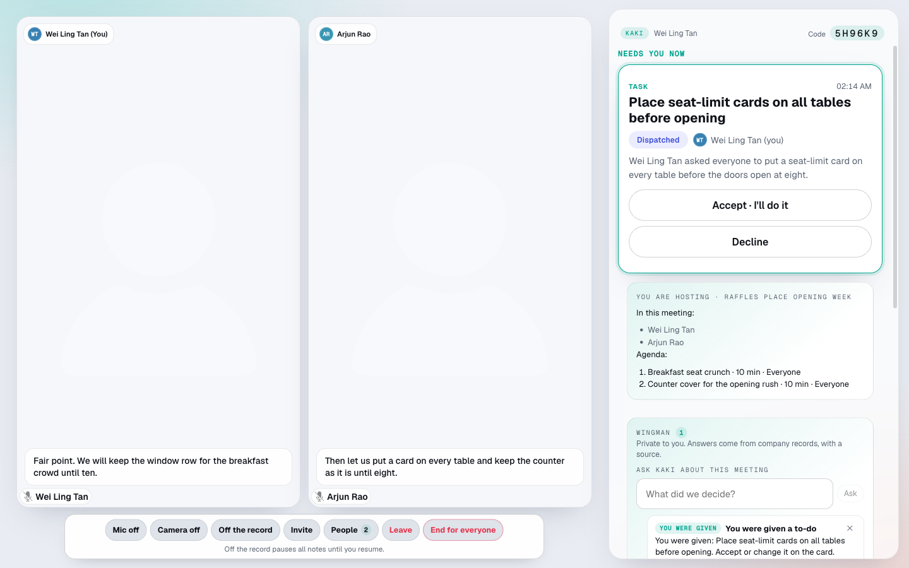
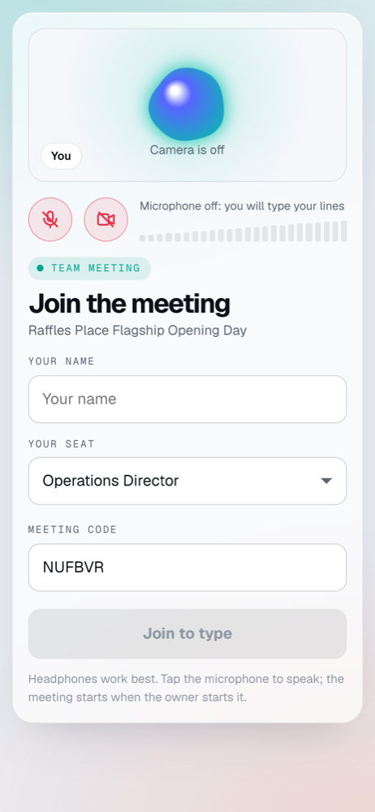
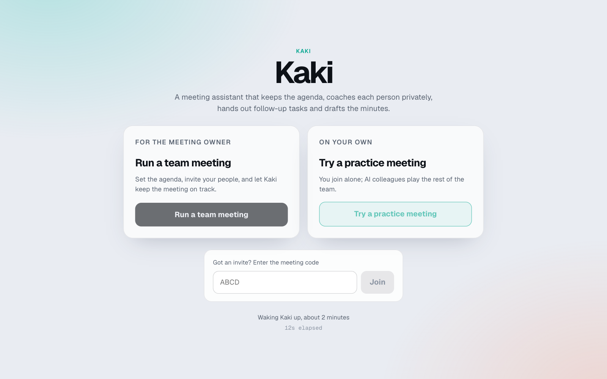
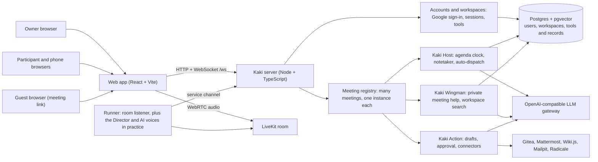

# Kaki

A meeting assistant that gives every seat a private wingman.

[Live demo](https://green-sky-0c9a41800.4.azurestaticapps.net) · [Screenshots](#screenshots) · [Architecture](#how-it-works) · [Run locally](#run-locally) · [Poster](docs/poster/kaki-a1-poster.pdf)


*A practice meeting. Kaki Wingman has just handed the Operations Director a private fact for the question on the table.*

Kaki (Singlish for "buddy" or "one of us") helps a small team run a meeting and finish the work it creates. A person signs in, gets a personal workspace, and connects the tools that workspace already uses. They start a meeting now or schedule it for later, invite people by link or QR code, and guests join under their own name without an account. Each person holds their own seat and gets a private wingman, while a neutral host keeps the clock and the notes. Follow-ups become to-do cards that a person can hand to Kaki to draft, and the minutes and to-dos stay in the workspace after the meeting ends. A practice meeting, where AI colleagues fill the other seats, is still one click away at `/practice` and `/demo`.

## Highlights

- Sign in with Google. Each person gets a personal workspace, and a read-only sample workspace (Nanyang Kopi) shows how the tools fit together.
- A workspace connects Mattermost, Gitea, a wiki, email and a calendar. Logins are stored encrypted with AES-GCM, and a Test button checks each connection.
- Start a meeting now or schedule it for later, describe it to Tell Kaki for a drafted agenda, or take the agenda from the calendar. Invite people by link or QR code, and guests join by link without an account.
- Many meetings can run at once. Each has its own notes, transcript and cards, and an open-meeting cap returns a plain busy message.
- Every person has their own seat and a private wingman that answers "what did I miss?" from the meeting first, then the workspace records with sources and dates. Guests get answers from the meeting only.
- A to-do card can be done for you: the owner presses Do it for me (tool), reviews the draft and approves it. At End, Send the notes posts to chat or emails the people who joined. Every post Kaki makes is signed "Posted by Kaki for <name>, approved in <meeting title>".
- After the meeting, the workspace keeps the minutes and to-dos, with Copy, Download and a tick for each to-do.
- A practice meeting with AI colleagues still runs at `/practice` and `/demo`, with the stage above the dock on narrow screens.

## Screenshots

<table>
  <tr>
    <td align="center"><br><sub>Choose a team meeting or a practice meeting.</sub></td>
    <td align="center"><br><sub>The join screen on a phone.</sub></td>
  </tr>
  <tr>
    <td align="center" colspan="2"><br><sub>The always-on start page wakes the cloud server when it is off.</sub></td>
  </tr>
</table>

## Team

| Name | Matriculation number | Area |
| --- | --- | --- |
| Xiao Xiao | A0332142W | Kaki Host |
| Joshua Lum Zi Yuan | A0108499N | Kaki Wingman |

## Contents

- [Highlights](#highlights)
- [Screenshots](#screenshots)
- [Team](#team)
- [Try it](#try-it)
- [Why Kaki](#why-kaki)
- [How it works](#how-it-works)
- [What's new](#whats-new)
- [Front-end features](#front-end-features)
- [Back-end features](#back-end-features)
- [Built with React](#built-with-react)
- [Technology choices](#technology-choices)
- [Engineering quality](#engineering-quality)
- [Run locally](#run-locally)
- [Integrations](#integrations)
- [Commands](#commands)
- [Project management](#project-management)
- [Competitor analysis](#competitor-analysis)
- [Legal and open source](#legal-and-open-source)
- [Business model](#business-model)
- [Credits](#credits)
- [Repository structure](#repository-structure)
- [Sources](#sources)

## Try it

Start at **[green-sky-0c9a41800.4.azurestaticapps.net](https://green-sky-0c9a41800.4.azurestaticapps.net)**. That page is always on. The demo itself runs on an Azure VM (HTTPS, so browsers and phones allow the microphone) that switches itself off when nobody is using it; if it is off, choosing an option on the start page wakes it, which takes a minute or two, and then takes you where you chose. The other links below work once it is awake.

Sign in with Google to open your workspace. The account menu lists your personal workspace and the read-only Nanyang Kopi sample workspace. In a workspace, connect the tools to use (Mattermost, Gitea, wiki, email, calendar), or use the sample's built-in tools. Open New meeting, describe the meeting to Tell Kaki or take the agenda from your calendar, then start it now or schedule it for later. Share the invite link or QR code; guests join by link under their own name without an account.

| What | Where | Sign-in |
| --- | --- | --- |
| Kaki app (workspaces and real meetings) | [kaki.southeastasia.cloudapp.azure.com](https://kaki.southeastasia.cloudapp.azure.com) | Sign in with Google |
| Practice meeting with AI colleagues | [/practice](https://kaki.southeastasia.cloudapp.azure.com/practice) or [/demo](https://kaki.southeastasia.cloudapp.azure.com/demo) | No sign-in |
| Wiki.js | [Port 8081](http://kaki.southeastasia.cloudapp.azure.com:8081) | `demo` / `demo` |
| Gitea | [Port 8082](http://kaki.southeastasia.cloudapp.azure.com:8082) | `demo` / `demo` (or `wei-ling`, `arjun`, `mei`, `daniel` / `demo`) |
| Mattermost | [Port 8443](https://kaki.southeastasia.cloudapp.azure.com:8443) | `demo` / `demo` (or `weiling`, `arjun`, `mei`, `daniel` / `demo`) |
| Mailpit inbox | [Port 8084](http://kaki.southeastasia.cloudapp.azure.com:8084) | No login |
| Radicale calendar | [Port 5232](http://kaki.southeastasia.cloudapp.azure.com:5232) | `demo` / `demo` |

In a real meeting, each person has their own seat under their own name (two people called Sam show as "Sam" and "Sam (2)") and no AI colleagues join. The room can go off the record, and anyone can leave and rejoin. The owner or an admin can end the meeting for everyone. In a practice meeting, the AI colleagues take the other seats and the visitor can speak or type.

The VM switches itself off after 60 minutes with nobody connected, or after 2 hours with nobody speaking, typing or clicking (a forgotten open tab). A meeting cut off this way is saved and comes back when the VM wakes. The waking page is in `wake/` and the switch-off check in `deploy/idle/`. You can also run Kaki locally with `npm start` (see [Run locally](#run-locally)).

```bash
npm run cloud:status   # Check the VM and the live HTTPS health endpoint
npm run cloud:up       # Start kaki-vm and wait until the site and integrations are ready
npm run cloud:down     # Deallocate kaki-vm ($0/hr compute billing)
```

## Why Kaki

A meeting host has to present, watch the clock, keep the agenda and record who agreed to do what, and in a hybrid meeting much of that is harder. When the person who knows the answer stays quiet, the question can sit open for the rest of the call.

Zoom AI Companion 3.0 drafts tasks and emails inside Zoom, and Otter.ai Live Assist gives private coaching tips while the call runs. The harder part is deciding when to stay silent, who needs which fact, and how to write into another system without surprising anyone. Kaki splits those jobs between a neutral host, a private wingman for each participant and an action agent that writes into the team's own tools.

Several parts were hard to get right. In a live meeting several people can talk at once, and each person's microphone is transcribed on its own, so the transcript has to keep their lines apart. A follow-up should not be sent until its agenda item is settled, and a private card must reach only one seat. In a practice meeting the AI colleagues have to take turns and stop when someone interrupts. A real meeting adds its own problems: many people at once, guests with no account, and a room that can go off the record.

In two years, personal help during a live meeting should feel as ordinary as the recap does today. In five, a team should expect the meeting to leave finished work behind, such as an issue opened and an email sent. In ten, the assistant should be part of how the team runs, with the open questions being trust and permission.

## How it works



The browser holds no API keys. It talks to the Kaki server and to LiveKit with a room token from the server. Every LLM call, Azure Speech call and company-tool write is made by the server or by the NPC runner.

A person signs in with Google. The server creates their personal workspace on first sign-in, and the built-in sample workspace is read-only for everyone. Tool logins are stored encrypted with AES-GCM under `KAKI_SECRET_KEY` and are never returned to the browser.

Many meetings can run in one server process. The registry loads each meeting on demand, gives it its own notes, transcript, tasks and socket audience, and caps how many are open at once. Meeting state is saved to Postgres, so a restart restores a meeting where it was. When a person joins, the server decides which messages their seat receives. A private card for one role never reaches another role's screen.

Company records sit in the same Postgres database, so a question can match a record by meaning as well as by its words.

| Agent | What it does | Code |
| --- | --- | --- |
| Kaki Host | Runs the agenda clock, keeps the meeting record, finds open questions and follow-ups, dispatches work to the right role and triggers the closing summary. | `server/src/host/` |
| Kaki Wingman | A private helper for one person. Answers "what did I miss?" and other questions from the meeting first and the workspace second (with sources and dates), notes a to-do given to them, flags a direct question they must answer, and surfaces a record that answers or contradicts the current discussion. Guests get meeting-only answers. | `server/src/wingman/` |
| Kaki Action | Drafts a concrete issue, post, email, wiki page or calendar event after a person presses Do it for me or claims the task, then runs it once they approve. At End it offers to send the notes to chat or email, and it drafts the minutes for a person to approve before the wiki write. | `server/src/action/` |
| NPC Director and runner | The runner joins every room as the silent listener for speech recognition. In a practice meeting it also plays the AI colleagues (NPCs in the code) over LiveKit. One Director speaks for every AI colleague, one at a time. The runner uses Azure Speech, voice-activity detection and barge-in (stops talking when someone talks over it). | `server/src/npc/` |

Here is the path of one follow-up in a real meeting. Someone says, "I'll email the supplier." The notetaker proposes a follow-up from that transcript line and keeps the evidence (`server/src/host/notetakerTasks.ts`). The owner dispatches it to that person's seat from the shared task list (`server/src/host/autoDispatch.ts`). The task store publishes the card only to their seat (`server/src/meeting/tasks.ts`), and the dock shows it privately (`web/src/meeting/room/ActiveRoleCards.tsx`). The owner presses Do it for me (email), edits the draft and presses Approve. The action runner checks the draft against its source and runs it (`server/src/action/runner.ts`, `server/src/action/draftGrounding.ts`). Mailpit receives the email (`server/src/action/email.ts`).

## What's new

Kaki now has accounts and workspaces. A person signs in with Google, gets a personal workspace, and can try the read-only Nanyang Kopi sample workspace. Each workspace connects its own Mattermost, Gitea, wiki, email and calendar, and the logins are stored encrypted with AES-GCM; a Test button checks a connection before a meeting needs it.

A meeting can start now or be scheduled for later. The owner types the agenda, describes the meeting to Tell Kaki for a draft, or takes the agenda from the calendar. People are invited by link or QR code, and guests join by link without an account under their own name.

Real meetings have no AI colleagues. Any number of people join, each with their own seat, and many meetings can run at once with their own notes, transcript and cards. An open-meeting cap returns a plain busy message. The room can go off the record, which is left out of the notes and shown in the minutes as a span; people can leave and rejoin; the owner or an admin ends the meeting for everyone.

Each person's private Wingman answers "what did I miss?" and other questions from the meeting first and workspace records second, with a source and date. A guest gets answers from the meeting only.

Follow-ups are to-do cards. The owner can press Do it for me (tool), review the draft and approve it, and the card syncs back. At End, Send the notes posts the minutes and to-dos to chat or emails the people who joined. The workspace keeps a history of each meeting with its minutes and to-dos, and a person can tick a to-do done, copy the notes or download them.

Questions and follow-ups are proposed only from transcript lines, and a second model pass judges whether the meaning matches. A doubtful case is left unresolved.

In a practice meeting, one person sits with four AI colleagues who speak in their own voices, take turns, react to what is said and stop when interrupted. The practice meeting still runs at `/practice` and `/demo`, and each visitor gets their own room.

## Front-end features

The web app is one React and Vite application. The product pages are `/signin` (Google sign-in), `/new` (new meeting), `/workspaces/:id` (workspace and tools), `/workspaces/:id/meetings/:meetingId` (meeting history), `/m/:id` (guest join) and `/m/:id/room` (real meeting room) (`web/src/product/`, `web/src/App.tsx`). The practice pages still work: `/practice` and `/demo` open the practice meeting. `/` is the landing page: it leads to Google sign-in and a new meeting, to the practice meeting, or to a real meeting's join page when someone types its meeting code. Any other path redirects to `/`.

The design uses shared colour and type tokens in `web/src/ui/tokens.css` and shared components in `web/src/ui` (`Button`, `Card`, `StatusPill`). The meeting stage takes the most space, private cards sit in the dock beside it, and on a narrow screen the stage stacks above the dock.

Screen map:

- `/` shows the landing page: sign in, start a team meeting, try a practice meeting, or enter a meeting code. A signed-in person goes straight to `/new`.
- `/signin` starts Google sign-in and returns to the page in `next`, or to `/new`.
- `/new` creates a real meeting now or for later, with a typed agenda, a Tell Kaki draft or a calendar import, and goes to `/m/:id/room`.
- `/workspaces/:id` lists the workspace's meetings and tools. An admin can connect, test and disconnect tools.
- `/workspaces/:id/meetings/:meetingId` shows the minutes and to-dos of an ended meeting, with Copy and Download.
- `/m/:id` is the guest join page, and `/m/:id/room` is the real meeting room.
- `/practice` and `/demo` open this visitor's own practice meeting. Any other path redirects to `/`.

### Plan the meeting (front end)

- A signed-in person creates a meeting at `/new`: choose a workspace, type the title and agenda, describe the meeting to Tell Kaki for a draft, or import the agenda from the calendar, then press Start now or Schedule for later. Field errors appear next to the input. `web/src/product/NewMeetingPage.tsx`, `web/src/product/api.ts`, `server/src/http/routes/agenda.ts`
- The workspace page lists its meetings and each connected tool, with connect, save, test and disconnect controls for an admin. `web/src/product/WorkspacePage.tsx`, `web/src/product/ToolSection.tsx`

### Invite and join (front end)

- The real meeting bar shares the invite link and a QR code, copies the link, and lists who has joined. `web/src/meeting/room/RealMeetingBar.tsx`
- A guest opens the link, enters a name and joins without an account. A scheduled meeting can be joined early. `web/src/product/JoinPage.tsx`
- A reload or a dropped connection restores the same name and seat while the grace window is open. `web/src/meeting/room/rejoinSession.ts`
- The practice join form takes a name and a seat with a microphone and camera check. `web/src/meeting/room/JoinForm.tsx`

### During the meeting (front end)

- The stage shows each person's LiveKit tile, who is speaking, live captions and reaction badges. In a practice meeting, AI colleagues appear as animated orbs. `web/src/meeting/room/MeetingGrid.tsx`, `web/src/meeting/room/CaptionedTile.tsx`, `web/src/meeting/room/Orb.tsx`, `web/src/meeting/room/stageModel.ts`
- A briefing covers the practice stage until the visitor presses Start. The AI colleagues stay silent before that. `web/src/meeting/room/StartPrompt.tsx`
- The dock carries the role card, the agenda clock, the transcript, the task board, the private Wingman panel and any private task card. `web/src/meeting/room/Dock.tsx`, `web/src/meeting/room/RoleCard.tsx`, `web/src/meeting/room/WingmanPanel.tsx`, `web/src/meeting/room/ActiveRoleCards.tsx`, `web/src/meeting/room/MeetingPanel.tsx`
- The real meeting bar has microphone and camera controls, Type, Off the record, Invite, People and Leave, plus End for everyone (owner or admin). An off-the-record banner shows while the room is off the record. `web/src/meeting/room/RealMeetingBar.tsx`, `web/src/meeting/room/RealRoomOverlays.tsx`, `web/src/meeting/room/TypeBar.tsx`
- Microphone and speaker controls show a live level. A phone can tap to start playback when the browser blocks it. `web/src/meeting/room/MediaPreview.tsx`, `web/src/meeting/room/AudioUnlock.tsx`
- Narrow screens put the stage above the dock and keep the type bar at the bottom. `web/src/meeting/room/demo.css`
- One hook holds the WebSocket connection, the event window, the task list and the send function. `web/src/kaki/useKaki.ts`

### After the meeting (front end)

- Each follow-up arrives as a card for one person. They can accept or decline, edit the draft and press Approve, or retry a failed write. In a real meeting the card can also offer Do it for me (tool), so Kaki drafts it for the owner. `web/src/meeting/room/ActiveRoleCards.tsx`, `web/src/meeting/room/TaskControls.tsx`
- The workspace history page shows the minutes and to-dos of an ended meeting, with Copy, Download and a tick for each to-do. `web/src/product/MeetingHistoryPage.tsx`, `web/src/product/EndedMeetingCard.tsx`
- The minutes arrive as an editable card assigned to a person in the room. The wiki link appears only after that person approves the page. `web/src/meeting/room/ActiveRoleCards.tsx`

### Practise alone

- `/practice` and `/demo` open a meeting where AI colleagues fill the other seats. The visitor can speak or type, and the AI stops when interrupted. `web/src/meeting/room/Meeting.tsx`, `web/src/meeting/room/TypeBar.tsx`

## Back-end features

### Platform

- One route table declares every HTTP path and its access level: public, user, session, host, host-or-practice, service, loopback or dev. An unlisted path returns 404. `server/src/app.ts`, `server/src/http/routes/`
- One WebSocket hub carries the typed protocol. Each event names its audience, and the server delivers it only to the connections that audience covers. `server/src/core/hub.ts`, `server/src/core/audience.ts`, `shared/src/events.ts`, `shared/src/commands.ts`
- The meeting registry loads each meeting on demand and gives it its own notes, transcript, tasks and socket audience. It unloads a meeting after 30 idle minutes by default, caps open meetings at `KAKI_MAX_OPEN_MEETINGS` (default 10), and returns a plain busy message when the cap is reached. `server/src/meeting/registry.ts`, `server/src/meeting/instance.ts`, `server/src/meeting/realMeeting.ts`
- A meeting row moves through scheduled, open and ended. An empty room keeps the same seats for a grace period, and a restored meeting keeps its state. `server/src/meeting/session.ts`, `server/src/meeting/rejoin.ts`, `server/src/persist/`
- Scenario packs supply roles, attendees, AI profiles, agenda, seed data and a replay transcript. `SCENARIO` names the folder to load. `server/src/core/loadScenario.ts`, `scenarios/README.md`
- Idempotent seed scripts load the Kopitiam company records into Gitea, Mattermost, Wiki.js, Mailpit, Radicale and Postgres. `docker/seed/index.ts`, `docker/seed/gitea.ts`, `docker/seed/mattermost.ts`, `docker/seed/wiki.ts`, `docker/seed/mail.ts`, `docker/seed/calendar.ts`, `docker/seed/postgres.ts`
- `npm start` checks Docker and `.env`, starts the seven containers, seeds the company, indexes knowledge, starts the server, web app and AI runner, then runs a preflight. `scripts/live-up.sh`
- `npm run cloud:up`, `cloud:down` and `cloud:status` manage the Azure VM. `scripts/cloud.sh`
- An always-on start page on Azure Static Web Apps (free plan) wakes the VM when a visitor picks an option, waits until Kaki answers, then sends them on. Its two small functions can only read the VM's state and start it. `wake/`
- The VM switches itself off. Every 5 minutes a check reads the server's idle state from a route only the VM itself can reach, and deallocates the VM after 60 minutes with nobody connected or 2 hours with no real person action. If it cannot read the server it stays on, and switches off only after 2 hours of that. `deploy/idle/`, `server/src/core/idle.ts`

### Authentication

- Sign-in is Google OAuth. With `KAKI_AUTH=1`, the server also needs `POSTGRES_URL` and `KAKI_SERVICE_TOKEN`; Google sign-in needs `KAKI_GOOGLE_CLIENT_ID`, `KAKI_GOOGLE_CLIENT_SECRET` and `KAKI_PUBLIC_URL`. A first sign-in creates the person's account and personal workspace, and sessions last 12 hours. `server/src/auth/module.ts`, `server/src/auth/google.ts`, `server/src/auth/store.ts`
- A guest joins one meeting through its link with a name and no account, and the guest session is bound to that meeting. `server/src/auth/module.ts`, `server/src/http/access.ts`
- Each workspace stores its tool logins encrypted with AES-256-GCM under `KAKI_SECRET_KEY`; the API returns only the non-secret settings, and an admin can test a connection with the Test button. `server/src/workspace/secrets.ts`, `server/src/workspace/tools.ts`, `server/src/http/routes/workspaces.ts`
- The built-in Nanyang Kopi sample workspace is read-only, is never a row, and uses the hosted services. `server/src/workspace/sample.ts`

### Plan the meeting (back end)

- The product creates a real meeting from a workspace, a title and an agenda that was typed, drafted by Tell Kaki or taken from the calendar. The title and every agenda item are checked before the row is written, and a future start time marks the meeting scheduled. `server/src/http/routes/meetings.ts`, `server/src/http/routes/agenda.ts`, `server/src/meeting/agenda.ts`
- The setup parser checks role ids, unique labels, agenda owners, seat kinds, nudge pace and required fields. `shared/src/setupParse.ts`, `shared/src/setupScenario.ts`

### Invite and join (back end)

- A real meeting is joined by its meeting id, which is the link, and a name. A signed-in person joins under their Google name without becoming a workspace member. `server/src/http/routes/meetings.ts`, `server/src/auth/module.ts`
- Meeting-code admission and LiveKit tokens take a seat through the same meeting record. `server/src/auth/module.ts`, `server/src/services/livekit.ts`, `server/src/http/routes/meeting.ts`, `server/src/meeting/session.ts`
- Meeting codes use six characters from an alphabet without look-alikes, with five attempts per address per minute. `server/src/meeting/meetingCode.ts`

### During the meeting (back end)

- The agenda clock tracks the current item, elapsed time, overrun, pause and resume, with a replay speed for scripted runs. `server/src/host/clock.ts`
- The notetaker turns new transcript lines into the meeting record. Separate passes handle questions and tasks, and a verifier judges meaning rather than word overlap. `server/src/host/notetaker.ts`, `server/src/host/notetakerQuestions.ts`, `server/src/host/notetakerTasks.ts`, `server/src/host/notetakerVerifier.ts`, `server/src/host/notetakerPrompt.ts`
- Suggested tasks are dispatched to their role. In a real meeting the person hosting sees the cards and dispatches from the shared task list. `server/src/host/autoDispatch.ts`
- Off the record: while it is on, the room's words are not transcribed, analysed or stored. The minutes show the span with no content. Any person in the meeting can turn it on or off. `server/src/meeting/instance.ts`, `shared/src/meetingState.ts`
- A person can leave and rejoin. The seat is held for a grace window, and rejoining restores the same name and seat. The owner or an admin can end the meeting for everyone, which marks the meeting row ended. `server/src/meeting/rejoin.ts`, `server/src/meeting/session.ts`, `server/src/meeting/registry.ts`
- The Wingman is private to one seat: it answers "what did I miss?" and other questions from the transcript, record and to-dos first, then the meeting workspace; notes a to-do they were given; pops a direct question they must answer; and stays silent otherwise. A guest gets meeting-only answers. `server/src/wingman/module.ts`, `server/src/wingman/prompts.ts`
- Company search merges pgvector cosine search with Postgres full-text search using reciprocal rank fusion, then writes a role-aware answer with a source and date for each fact. `server/src/wingman/knowledge/search.ts`, `server/src/wingman/knowledge/gateway.ts`
- The runner joins every room as a silent listener and recognises each person's speech with Azure STT. In a practice meeting the NPC Director also plays every AI colleague from the scenario profiles, publishes audio, synthesises with Azure TTS, and stops on barge-in. `server/src/npc/director.ts`, `server/src/npc/conversation.ts`, `server/src/npc/runner.ts`, `server/src/npc/vad.ts`, `server/src/npc/speechGate.ts`

### After the meeting (back end)

- The task store is the only code that changes task state. It enforces `SUGGESTED`, `DISPATCHED`, `CLAIMED`, `DRAFT_READY`, `RUNNING`, `COMPLETED`, `FAILED` and `SYNCED`, and only the assignee can approve. `server/src/meeting/tasks.ts`
- Kaki Action drafts the artifact for an accepted task, either after Do it for me or when the assignee claims it, and checks the draft against its source before it runs. `server/src/action/runner.ts`, `server/src/action/draft.ts`, `server/src/action/draftGrounding.ts`
- Five connectors write to Gitea issues, Mattermost posts, Mailpit email, Wiki.js pages (through its GraphQL API) and Radicale calendar events. Each post or email ends with "Posted by Kaki for <name>, approved in <meeting title>". `server/src/action/footer.ts` `server/src/action/gitea.ts`, `server/src/action/mattermost.ts`, `server/src/action/email.ts`, `server/src/action/wiki.ts`, `server/src/action/calendar.ts`
- On the closing signal, Kaki builds Markdown minutes from the record, tasks and transcript, including any off-the-record span, assigns the card to a person in the room, and writes to Wiki.js only after that person approves. It also offers Send the notes to a Mattermost channel or by email to the people who joined. `server/src/action/wiki.ts`
- Kaki keeps its own copy of the minutes and to-dos with the meeting row, so the workspace history can show them and tick to-dos done. `server/src/meeting/registry.ts`, `server/src/http/routes/workspaces.ts`
- The knowledge indexer reads Wiki.js, Gitea, Mattermost, Mailpit and Postgres, chunks the records and writes 1024-dimension `bge-m3` embeddings. `server/src/wingman/knowledge/indexer.ts`, `server/src/wingman/knowledge/cli.ts`

## Built with React

| React idea | Where Kaki uses it | Why |
| --- | --- | --- |
| Components and typed props | `MeetingGrid`, `CaptionedTile`, `RoleCard`, `Dock` in `web/src/meeting/room/` | Stage tiles and dock cards take explicit props, so the same card renders for an owner, a participant or a practice visitor. |
| Side effects with `useEffect` | `web/src/kaki/useKaki.ts`, `web/src/meeting/room/Meeting.tsx` | The WebSocket reconnects and the LiveKit connection and rejoin flow start and stop with the page. |
| Refs with `useRef` | `web/src/kaki/useKaki.ts`, `web/src/kaki/ScenarioContext.tsx` | Socket handles, pending typed lines and load ordering must survive renders without causing another render. |
| Custom hooks | `useKaki` (`web/src/kaki/useKaki.ts`), `useScenario` and `useRefreshScenario` (`web/src/kaki/ScenarioContext.tsx`), `useMe` (`web/src/auth/useMe.ts`) | Each hook packages one piece of shared behaviour: live events, the active scenario and the sign-in check. |
| Context with `createContext` | `web/src/kaki/ScenarioContext.tsx` | Every page reads the same scenario without passing it through each component. |
| Routing with React Router 7 | `web/src/App.tsx`, `useNavigate` in `LandingPage`, `JoinPage`, `LoginPage` and `SetupPage`, `useSearchParams` in `JoinPage`, `SignInPage`, `LoginPage` and `ParticipantJoinPage` | The routes cover the landing, sign-in, new-meeting, workspace, join and meeting flows, and the invite code travels in the URL. |
| Controlled forms and validation | `web/src/meeting/room/JoinForm.tsx`, `web/src/product/NewMeetingPage.tsx` | Submit stays disabled until required fields are valid, and the server's refusal appears next to the form. |
| Error boundary | `web/src/meeting/room/ErrorBoundary.tsx`, used in `Dock` | A broken card shows an error instead of taking down the meeting page. |
| LiveKit React components | `LiveKitRoom`, `useTracks`, `ParticipantTile`, `RoomAudioRenderer`, `useRoomContext` from `@livekit/components-react` | The room, tiles and audio renderer come from the LiveKit React package. |
| Plain CSS | `web/src/ui/tokens.css`, `web/src/ui/ui.css`, `web/src/meeting/room/demo.css`, `web/src/product/product.css` | Shared colour and type tokens keep the pages uniform, and media queries restack the meeting room on a phone. |
| Vite dev server with proxy | `web/vite.config.ts` | `/api`, `/health`, `/ws` and `/dev` reach the Kaki server during development, and only this machine may call `/dev`. |

Kaki uses React 19, React Router 7 and Vite 8.

## Technology choices

Kaki uses React with React Router and plain CSS on the front end, a Node and TypeScript server, and GraphQL as a client of Wiki.js. It does not use MongoDB or React Native; the reasons are in the table.

| Choice | What Kaki uses | Why |
| --- | --- | --- |
| Front end | React 19, React Router 7, Vite and plain CSS (`web/src/**/*.css`, shared tokens in `web/src/ui/tokens.css`) | One single-page app serves the landing page, the product pages and the meeting room, with no CSS framework to learn or override. |
| Phones | A responsive web app, not React Native | Guests join from a phone by link or QR code with no install. The same React pages and the same LiveKit WebRTC client run in a phone browser, so there is one code base to test. |
| GraphQL | Client of the Wiki.js GraphQL API | Wiki.js only exposes pages through GraphQL, so Kaki logs in, reads, searches and writes minutes with GraphQL queries and mutations (`server/src/action/wiki.ts`, `server/src/workspace/connectors/wiki.ts`, `server/src/wingman/knowledge/indexer.ts`). Kaki's own API is not GraphQL. |
| Live API | REST routes plus a WebSocket hub | Setup, sign-in, meeting codes and approvals are request/response calls, so REST keeps each one small and direct. The meeting also needs live pushes to one seat, so one WebSocket stream carries events with an audience and the server routes each one. GraphQL subscriptions would add a query layer over the same push path. |
| Database | PostgreSQL with pgvector, not MongoDB | Company records, meeting state, sessions and 1024-dimension embeddings live in one transactional database. Hybrid vector and full-text search runs in the same place, so a search sees the same records the meeting uses. Users, workspaces and meetings are related rows, which suit SQL. A self-hosted MongoDB would need a separate vector index for that search (MongoDB Atlas has vector search built in). |
| Language | TypeScript end to end with a shared protocol package | `shared/` holds events, commands, task states and parsers that both the server and the web app compile against. |
| Real-time audio | LiveKit | The meeting room, room tokens and WebRTC audio come from one self-hosted server. |
| Speech | Azure Speech | Recognition runs server-side for meeting speech, and multi-voice synthesis runs for the AI colleagues in a practice meeting. |
| Local stack | Docker Compose | Seven services start together and seed from the same scenario data. |

## Engineering quality

The repository is a TypeScript workspace with three packages: `shared/`, `server/` and `web/`. `shared/` holds the protocol and the rules both sides must agree on, including events, commands, task states, scenario parsing and setup parsing. The server is split by responsibility (`core`, `http`, `meeting`, `host`, `wingman`, `action`, `npc`, `auth`, `workspace`, `persist`, `services`). The web app is split by page and feature (`product`, `landing`, `auth`, `setup`, `meeting`, `kaki`, `ui`, `net`), with shared buttons, cards, labels and artifact links in `web/src/ui/`. Every exported function, component and type carries a short comment.

Input is checked on both sides. The product checks the meeting title, agenda and tools before a write, and the setup parser checks a plan before it is used. Commands from a socket are validated against the scenario before the hub accepts them. The action connectors reject a draft that adds details its source does not support.

Web tests sit next to their components. The server, shared and seed tests live in their own test folders (`server/test/`, `shared/test/`, `docker/seed/`), and the script helpers are tested in `scripts/`. `npm test` runs the Vitest suite for all of them, including unit tests and integration tests that drive the HTTP and WebSocket API. `npm run typecheck` checks the whole workspace.

Playwright drives the real app in installed Google Chrome:

- The click-through journeys in `scripts/clickthrough/` drive the real product: the sign-in page, a signed-in workspace tool test, a start-now meeting with a guest, off the record, End and the minutes, a scheduled meeting, the sample workspace, the practice page and a phone layout. Each run writes screenshots and a findings report to `.live-logs/clickthrough/`.

`npm run eval:notetaker -- --ami` measures the notetaker on real, unscripted recorded meetings from the AMI Meeting Corpus. It replays each transcript, and a model judge pairs what the notetaker found with the corpus's own summary of follow-up actions and open problems. Two of the six meetings (`--holdout`) were kept out of all tuning, to check that changes hold for meetings the notetaker was not adjusted on. Results from 22 Nov 2026, before and after making the open-question handling general (two runs per meeting, both measured the same day):

| Meetings | Open problems caught | Extra questions per meeting | Follow-ups caught | Extra follow-ups per meeting |
| --- | --- | --- | --- | --- |
| 4 working meetings, before | 41% | 11.5 | 59% | 0.8 |
| 4 working meetings, after | 78% | 2.6 | 59% | 1.8 |
| 2 hold-out meetings, before | 28% | 9.5 | 21% | 0 |
| 2 hold-out meetings, after | 50% | 3.3 | 14% | 0 |

"Extra" items are ones the corpus summary does not list. Many extra follow-ups are real work the summary leaves out, such as checking whether a feature is technically possible. Follow-ups in the hold-out meetings are mostly informal work splits ("you take the interface design"), which the notetaker rarely turns into cards.

See [How we tested Kaki](docs/testing.md) for the full test map.

## Run locally

Requires Node 22+ and Docker Desktop.

Copy `.env.example` to `.env` and fill the five required keys: an OpenAI-compatible LLM gateway (`KAKI_LLM_BASE_URL`, `KAKI_LLM_API_KEY`, `KAKI_LLM_MODEL`) and Azure Speech (`AZURE_SPEECH_KEY`, `AZURE_SPEECH_REGION`).

```bash
cp .env.example .env
npm start
```

`npm start` installs dependencies if `node_modules` is missing, starts the seven Docker containers, seeds the **Nanyang Kopi & Toast (`kopitiam`)** scenario into Postgres, Wiki.js, Gitea, Mattermost, Mailpit and Radicale Calendar, indexes the knowledge chunks into pgvector, starts the Kaki server on port 3001, the Vite web app on port 5173 and the AI runner, then runs the preflight. It stops with the exact fix if Docker is not running, `.env` is missing or a required key is empty. The seed generates the Gitea and Mattermost tokens in `docker/.env`, and `npm start` passes them to Kaki.

Open `http://localhost:5173` in Chrome. The practice meeting is at `/practice` and `/demo`; the product pages are `/signin`, `/new` and `/workspaces/:id`.

To use the product pages locally, set `KAKI_AUTH=1`, `KAKI_GOOGLE_CLIENT_ID`, `KAKI_GOOGLE_CLIENT_SECRET` and `KAKI_PUBLIC_URL` (the address Google returns to), set `KAKI_SERVICE_TOKEN` so the AI runner can reach the meeting, and set `KAKI_SECRET_KEY` to 32 random bytes, base64-encoded, so a workspace can store tool logins. `KAKI_MAX_OPEN_MEETINGS` caps how many meetings run at once (default 10). `npm start` wires `POSTGRES_URL` from `docker/.env`.


```bash
npm stop              # Stop the Kaki server, web app and AI runner
npm stop -- --stack   # Also stop the Docker containers
```

### Integrations

All backing services run through [`docker/docker-compose.yml`](docker/docker-compose.yml). Wiki.js, Gitea, Mattermost and Radicale use `demo` / `demo`; the table below gives the Postgres and LiveKit credentials. See [docker/README.md](docker/README.md).

| Integration | Purpose | Local endpoint | Login | Module |
| --- | --- | --- | --- | --- |
| Gitea | Creates engineering and ops issues from approved drafts | `http://127.0.0.1:8082` | `demo` / `demo` (or `wei-ling`, `arjun`, `mei`, `daniel` / `demo`) | `server/src/action/gitea.ts` |
| Mattermost | Posts announcements and updates to team channels | `http://127.0.0.1:8083` | `demo` / `demo` (or `weiling`, `arjun`, `mei`, `daniel` / `demo`) | `server/src/action/mattermost.ts` |
| Wiki.js | Publishes team wiki pages and approved minutes | `http://127.0.0.1:8081` | `demo` / `demo` | `server/src/action/wiki.ts` |
| Mailpit | Sends drafted emails over SMTP and serves a web inbox | `http://127.0.0.1:8084` | No login | `server/src/action/email.ts` |
| Radicale (CalDAV) | Books `.ics` calendar events and serves the seeded calendar | `http://127.0.0.1:5232` | `demo` / `demo` | `server/src/action/calendar.ts` |
| PostgreSQL + pgvector | Stores company records and 1024-dimension `bge-m3` embeddings | `127.0.0.1:5433` | `kaki` / `kaki_dev_password` | `server/src/wingman/knowledge/` |
| LiveKit + Azure Speech | WebRTC audio room, server VAD, STT and multi-voice TTS | `ws://127.0.0.1:7880` | `devkey` / `secret` | `server/src/npc/` |

When a person joins with their name, Kaki updates the `demo` profile display name in Gitea and Mattermost to match, or posts from the person's own account when it exists. Tasks completed by an AI colleague are posted from that colleague's account (`arjun`, `mei`, `daniel`, `weiling` or `wei-ling`).

### Commands

```bash
npm start                 # One-command local demo: checks, Docker, seed, index, server + web + AI, preflight
npm stop                  # Stop local server, web app and AI runner (add -- --stack for Docker)
npm run cloud:up          # Start the Azure VM and wait for the live site
npm run cloud:down        # Deallocate the Azure VM ($0/hr compute billing)
npm run cloud:status      # Check the VM state and live HTTPS health
npm run stack:up          # Start the seven Docker containers
npm run stack:down        # Stop the Docker containers
npm run seed              # Idempotently seed all Docker services with the Kopitiam scenario
npm run seed:verify       # Run the automated health and content checks against the Docker stack
npm run index:knowledge   # Embed and index seeded company records into pgvector
npm run knowledge:check   # Verify live pgvector search and role-filtered facts
npm run npc               # Run the AI runner against a local stack
npm run typecheck         # Type-check all workspaces
npm test                  # Run the full Vitest suite
```

See [The live demo meeting](docs/live-demo.md) for the practice meeting flow and [Domain glossary](CONTEXT.md) for the project vocabulary.

## Project management

Work was tracked in GitHub issues for `IT5007-2610/it5007-courseproject-group-14`, read and updated with the `gh` CLI. The labels follow five triage roles: `ready-for-agent`, `needs-triage`, `needs-info`, `ready-for-human` and `wontfix`.

The repository has 581 commits from 21 October to 22 November 2026 (`git rev-list --count HEAD`).

The plan ran in phases: the core stack and protocol first, then the three agents, then the live meeting and demo, then the submission clean-up. Each phase closed with review rounds on architecture, security and how real people use the demo; their findings became issues and fix commits. Notes from people testing the demo became issues and then automated playtests, described in [How we tested Kaki](docs/testing.md).

| Issue | Title |
| --- | --- |
| [#2](https://github.com/IT5007-2610/it5007-courseproject-group-14/issues/2) | [Core] Docker Compose Stack & Mock Multi-Source Knowledge Bases |
| [#6](https://github.com/IT5007-2610/it5007-courseproject-group-14/issues/6) | [Wingman] Multi-Role Participant Client & Role-Based Private Nudge Engine |
| [#7](https://github.com/IT5007-2610/it5007-courseproject-group-14/issues/7) | [Wingman] Private Fact Retrieval Interface via pgvector |
| [#8](https://github.com/IT5007-2610/it5007-courseproject-group-14/issues/8) | [Action] Background Worker Runtime & Gitea Issue Creation Tool |
| [#9](https://github.com/IT5007-2610/it5007-courseproject-group-14/issues/9) | [Action] Mattermost Notification Tool & Async Lifecycle Reporting |
| [#10](https://github.com/IT5007-2610/it5007-courseproject-group-14/issues/10) | [Integration] Human-in-the-Loop Task Dispatch to Sync-Back Flow |
| [#11](https://github.com/IT5007-2610/it5007-courseproject-group-14/issues/11) | [Demo] Scripted Replay, Demo Video & Demo Day |
| [#12](https://github.com/IT5007-2610/it5007-courseproject-group-14/issues/12) | [Core] Shared skeleton & message contract |
| [#13](https://github.com/IT5007-2610/it5007-courseproject-group-14/issues/13) | [Action] Email tool (Mailpit) |
| [#14](https://github.com/IT5007-2610/it5007-courseproject-group-14/issues/14) | [Core] Live meeting: LiveKit room, speech recognition and Kaki's voice (was: Zoom) |
| [#16](https://github.com/IT5007-2610/it5007-courseproject-group-14/issues/16) | [Core] Sign-in & sessions |
| [#18](https://github.com/IT5007-2610/it5007-courseproject-group-14/issues/18) | [Core] One-command start |
| [#39](https://github.com/IT5007-2610/it5007-courseproject-group-14/issues/39) | [Host] Keep meeting state across a server restart |
| [#44](https://github.com/IT5007-2610/it5007-courseproject-group-14/issues/44) | [Wingman] Upgrade Knowledge Search to Hybrid RAG (Vector + Full-Text) |
| [#63](https://github.com/IT5007-2610/it5007-courseproject-group-14/issues/63) | [Docs] Repo clean-up before submission |
| [#64](https://github.com/IT5007-2610/it5007-courseproject-group-14/issues/64) | [Core] Code organisation before submission |

Commit messages carry the issue number, for example `docs(code): a plain-language comment on every exported function, component and type (#64)` and `fix(meeting): review follow-ups: echo after barge-in, settle without an id, Kopitiam copy as scenario data, moves follow the agenda clock (#62)`.

## Competitor analysis

Checked on 1 November 2026. Every source below is vendor-authored, either a press release, product page or help article. Dates are the page's own publication or update date where shown, or "live page" where the page carries no date.

| Product | What its own source describes | Actions and approval | Source |
| --- | --- | --- | --- |
| Kaki | A host, a private wingman per seat and an action module in one meeting; live agenda clock, private fact cards, grounded notetaker and minutes | Drafts a Gitea issue, Mattermost post, Wiki.js page, email or calendar event. The assignee reviews and approves each draft before it runs; minutes wait for a person's approval before the wiki write | This repository |
| Zoom AI Companion 3.0 | Agentic retrieval across Zoom and connected apps; a follow-up template that drafts tasks and emails; personal workflows (beta) that auto-execute follow-ups; My Notes transcription | Follow-ups are drafted inside Zoom, and personal workflows can execute them automatically | [Zoom newsroom](https://news.zoom.com/zoom-launches-ai-companion-3-0/) |
| Microsoft Copilot in Teams | Real-time summary and suggested action items in a private per-person chat; catch-up for late joiners; intelligent recap needs Teams Premium or a Copilot licence | Suggested action items and recaps live inside Microsoft 365 | [Microsoft Support](https://support.microsoft.com/en-us/office/get-started-with-copilot-in-microsoft-teams-meetings-0bf9dd3c-96f7-44e2-8bb8-790bedf066b1) |
| Otter.ai | Live Assist gives private real-time coaching tips; Work Mode produces pre-meeting briefs and follow-ups such as CRM updates and emails, ready to review and send; a Jira connector auto-creates issues and can query Jira through AI Chat | Prepared inside Otter for a person to review and send; the Jira connector creates issues from detected action items | [Otter press release](https://otter.ai/blog/otter-rethinks-the-meeting-new-ai-preps-you-coaches-you-and-follows-through), [Otter Jira connector](https://help.otter.ai/hc/en-us/articles/40485786582551-Connect-Jira-to-Otter-ai) |
| Fireflies.ai | Transcription and summaries; Live Assist for real-time suggestions, coaching and answers; speaker talk-time analytics; AI Skills for follow-up work; Voice Agents | Follow-up work runs through AI Skills and integrations | [fireflies.ai](https://fireflies.ai/) |
| Read.ai | Ask Read actions: update a CRM deal, send email, create calendar events, scheduled email updates | A draft email is reviewed and then sent on the user's command; other actions run from Ask Read | [Read Help Center](https://support.read.ai/hc/en-us/articles/48863788829971-Using-Ask-Read-actions) |

Several competitors offer private in-meeting tips and write-back to connected tools. Kaki gives one person private, sourced help without addressing the room, and asks the task owner to approve a draft before anything is written. Competitors are stronger in meeting-platform coverage, transcription at scale, ready-made integrations and enterprise security certification. Kaki aims at small teams that already self-host their issue tracker, chat and wiki.

## Legal and open source

The main libraries are permissive. React, React DOM, React Router, Vite, `qrcode`, `ws`, `pg`, `tsx` and Vitest are MIT. `nodemailer` is MIT-0. The LiveKit client, React components, server SDK and Node SDK are Apache-2.0. The Microsoft Cognitive Services Speech SDK is MIT. TypeScript and Playwright are Apache-2.0. These licences were read from `node_modules/<package>/package.json`.

The Docker services run as unmodified images next to the code, not inside it.

| Service | Licence |
| --- | --- |
| PostgreSQL with pgvector | PostgreSQL Licence |
| Wiki.js | AGPL-3.0 |
| Gitea | MIT |
| Mattermost Team Edition | Source is AGPL-3.0; compiled binaries are released under MIT |
| Radicale | GPL-3.0 |
| Mailpit | MIT |
| LiveKit server | Apache-2.0 |

The copyleft terms do not reach Kaki's own code because each service runs as a separate process and talks to Kaki over HTTP or its own protocol. A change made inside one of those projects would be covered by that project's licence; calling the service does not relicense the caller. This is our reading, not legal advice.

Meeting audio and transcripts are personal data. A real deployment would need every attendee's consent, a retention limit and a decision on where transcripts are kept. In the demo, the live meeting carries audio through LiveKit and sends speech to Azure Speech for recognition; transcript text goes to the LLM gateway set in `.env`. With `KAKI_REPLAY=1` the host reads a scripted transcript instead of live audio. Debug audio capture is off unless `NPC_DEBUG_AUDIO_DIR` is set, and that folder is gitignored.

Nanyang Kopi & Toast, its people, records, email addresses and credentials are fictional and exist only for the demo. The `demo` / `demo` logins on Wiki.js, Gitea, Mattermost and Radicale are local development values.

No keys are committed. `.env` is gitignored, `.env.example` lists the required key names with empty values, and the seed writes generated Gitea and Mattermost tokens to the gitignored `docker/.env`. The browser never receives an LLM, Azure or service token.

## Business model

The recommended model is open core.

- Publish the meeting protocol, host, wingman and web client under AGPL-3.0. Keep the hosted service, support and enterprise connectors commercial. AGPL requires anyone who offers a modified Kaki over a network to publish its source, so a closed hosted fork would need the commercial licence. Apache-2.0 is easier for adoption but allows a closed fork.
- Customers are small teams that already self-host or pay for Gitea, Mattermost or similar tools, and lose follow-ups after meetings.
- Charge a per-host monthly subscription with a free tier for a few meetings a month. The self-hosted version is free; the managed service, support and team features are paid.
- Cost drivers are speech recognition and synthesis minutes, LLM calls for the notetaker, verifier, search and conversation, and hosting for the meeting server and NPC runner.
- Register the Kaki name and logo as trademarks. Require a contributor licence agreement so all code can be relicensed commercially. Keep proprietary features such as SSO, audit logs and an admin console out of the open repository.

## Credits

External services and APIs:

| What | Used for |
| --- | --- |
| OpenAI-compatible LLM gateway | Notetaker, verifier, action drafts, the NPC Director and conversation, and the final company-search answer |
| `bge-m3` embeddings through the same gateway | 1024-dimension company-record vectors for pgvector |
| Azure Speech | Server-side speech recognition for meeting speech and multi-voice text-to-speech for the AI colleagues in a practice meeting |
| LiveKit | WebRTC audio room for the meeting and the NPC runner |
| Wiki.js, Gitea, Mattermost, Mailpit, Radicale | Self-hosted company systems used as search sources and action targets; Wiki.js is reached through its GraphQL API |

The notetaker evaluation uses meetings from the [AMI Meeting Corpus](https://groups.inf.ed.ac.uk/ami/corpus/) (Carletta et al., 2005), licensed under [CC BY 4.0](https://creativecommons.org/licenses/by/4.0/). The transcripts in `scenarios/ami-eval/meetings/` are converted from the corpus word files, with speakers named by their role.

The reciprocal rank fusion in `server/src/wingman/knowledge/search.ts` implements the published RRF formula with `k = 60`.

Kaki was built for IT5007 at the National University of Singapore.

No code was copied from other projects, tutorials or repositories. We wrote the code with the help of AI coding assistants (Claude Code and others), and all design decisions and final code are our own responsibility. Kaki uses the open-source libraries and services listed in [Legal and open source](#legal-and-open-source) under their licences.

## Repository structure

```text
├── shared/                 # Typed protocol: events, commands, tasks, scenarios and setup
│   └── src/
├── server/
│   ├── src/action/         # Kaki Action connectors (Gitea, Mattermost, email, Wiki.js, calendar)
│   ├── src/auth/           # Google sign-in, sessions, guest joins and meeting-code admission
│   ├── src/core/           # Hub, audience routing, event projection, scenario loading
│   ├── src/host/           # Kaki Host (agenda clock, grounded notetaker, auto-dispatch, replay)
│   ├── src/http/           # Access levels, HTTP helpers and one route file per area
│   ├── src/meeting/        # Meeting registry, real meetings, codes, sessions, rejoin, tasks
│   ├── src/npc/            # Room listener for every meeting; in practice, NPC Director, VAD, barge-in, Azure STT/TTS
│   ├── src/persist/        # Meeting persistence and reset
│   ├── src/services/       # Shared LiveKit and LLM clients
│   ├── src/wingman/        # Kaki Wingman (private meeting help, pgvector search, knowledge indexer)
│   ├── src/workspace/      # Workspaces, per-workspace tools and encrypted tool secrets
│   └── test/               # Integration tests and fixtures
├── web/
│   ├── src/auth/           # Sign-in check hook and session API
│   ├── src/kaki/           # Scenario context, WebSocket hook and topic speech
│   ├── src/landing/        # Public landing page
│   ├── src/meeting/        # Shared meeting overlays
│   ├── src/meeting/room/   # Meeting stage, dock, captions, real-meeting bar, task cards and phone layout
│   ├── src/net/            # Fetch timeout helper
│   ├── src/product/        # Sign-in, new meeting, workspace, join, real room and meeting history
│   └── src/ui/             # Shared buttons, cards, labels and artifact links
├── scenarios/kopitiam/     # Nanyang Kopi & Toast scenario, seed data and replay fixtures
├── docker/                 # Docker Compose stack and idempotent multi-service seed scripts
├── scripts/                # Local and cloud launchers, preflight, dialogue playtest and click-through journeys
├── wake/                   # Always-on waking page and its start/status API (Azure Static Web Apps)
├── deploy/idle/            # VM idle check that switches the cloud VM off when nobody uses it
└── docs/                   # Live demo guide, testing guide, screenshots and STePS poster
```

## Sources

Competitor rows (all vendor-authored; see the table for dates and status):

- [Zoom AI Companion 3.0 press release](https://news.zoom.com/zoom-launches-ai-companion-3-0/) (15 Dec 2025)
- [Copilot in Microsoft Teams meetings](https://support.microsoft.com/en-us/office/get-started-with-copilot-in-microsoft-teams-meetings-0bf9dd3c-96f7-44e2-8bb8-790bedf066b1) (live page)
- [Otter Work Mode and Live Assist press release](https://otter.ai/blog/otter-rethinks-the-meeting-new-ai-preps-you-coaches-you-and-follows-through) (27 Oct 2026)
- [Connect Jira to Otter.ai](https://help.otter.ai/hc/en-us/articles/40485786582551-Connect-Jira-to-Otter-ai) (updated 15 May 2026)
- [fireflies.ai homepage](https://fireflies.ai/) (live page)
- [Using Ask Read actions](https://support.read.ai/hc/en-us/articles/48863788829971-Using-Ask-Read-actions) (updated 26 Oct 2026)

Other sources:

- [Mattermost licence FAQ](https://docs.mattermost.com/product-overview/faq-license.html)
- [Wiki.js repository](https://github.com/requarks/wiki)
